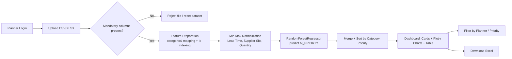

# BEACON — Supply Chain Intelligence & Decision Management

**AI-assisted prioritization for supply chain exception management**


---

## 1. Project Overview

BEACON is a web-based decision-support tool for supply chain planners who manage large volumes of purchase/supply order exceptions (past due orders, reschedules, cancellations, inventory imbalance flags, etc.). Planners currently triage these exceptions manually using spreadsheet reports, which scales poorly across thousands of order lines and multiple planners.

BEACON lets a planner upload a standard exception/detail report (CSV or Excel), automatically scores every record with a trained machine learning model, and surfaces an AI-generated priority ranking alongside summary statistics and exception-distribution charts — so planners can focus on the highest-impact items first.

## 2. Key Features

- **Secure login** with per-user session and per-user activity logging.
- **File upload** (CSV / XLSX) with schema validation against mandatory columns before processing.
- **AI-driven prioritization** of every uploaded record using a pre-trained `RandomForestRegressor` model.
- **Interactive dashboard** with summary cards: number of records, high-priority ticket count, selected planner/supplier, and exception count.
- **Dynamic Plotly charts**: Item Exception Flag distribution and Exception-type distribution, re-rendered per planner/priority filter selection.
- **Planner / priority filtering** — view aggregated results for a single planner or for all planners combined.
- **Downloadable results** — export the filtered, prioritized dataset back to Excel.
- **Per-user audit logs** stored under `logs/`.

## 3. How It Works

1. Planner logs in; credentials are validated against a user store.
2. Planner uploads a detail report (CSV/XLSX) containing the mandatory exception columns.
3. The backend validates the schema, then runs feature preparation, categorical mapping, and min-max normalization on the required columns.
4. The normalized feature set is passed to the pre-trained Random Forest model, which outputs an `AI_PRIORTY` score per record.
5. Records are merged back with original data, sorted by category and priority score, and stored in session-scoped application state.
6. The dashboard renders summary cards, two Plotly bar charts (exception type / exception flag distribution), and the full prioritized record table.
7. Planner can filter by Planner Name / Priority scope, or download the current view as an Excel file.



## 4. Technology Stack

| Layer | Technology |
|---|---|
| Web framework | [Quart](https://pgjones.gitlab.io/quart/) 0.20.0 (async Flask-compatible) |
| ASGI server | Hypercorn 0.17.3 |
| ML / data processing | scikit-learn 1.7.1, pandas 2.3.1, numpy 2.3.2, scipy 1.16.1 |
| Visualization | Plotly 5.22.0 (server-rendered JSON, client-rendered via `plotly-latest.min.js`) |
| File I/O | openpyxl 3.1.5 (Excel read/write) |
| Templating | Jinja2 (via Quart), HTML/CSS/vanilla JS (`static/js/main.js`) |
| ML Algorithm | `RandomForestRegressor` (scikit-learn), persisted via `pickle` |

## 5. Project Structure

```
task_priority_v0.1/
├── app.py                     # Quart application: routes, session handling, app wiring
├── config.json                # Legacy/auxiliary user map (not used for auth at runtime)
├── reqirements.txt            # Python dependencies
├── json/
│   └── user_config.json       # Active user credential store (used by login route)
├── src/
│   ├── utility.py             # Feature/column mappings, dropdown metadata defaults
│   └── functions.py           # Logging, aggregation, chart building, prediction pipeline
├── templates/
│   ├── base.html               # Shared layout/navigation
│   ├── login.html               # Login page
│   └── home.html                 # Dashboard: cards, upload form, charts, table
├── static/
│   ├── css/                   # Stylesheets (login.css, style.css)
│   ├── js/main.js             # Client-side chart fetch/render logic
│   └── images/                # UI icons
├── artifacts/
│   ├── model/random_forest_model.pkl   # Pre-trained prediction model
│   └── *.csv / *.xlsx                   # Sample/reference data files
└── logs/
    └── <username>.log         # Per-user activity log files
```

## 6. Prerequisites

- Python **3.13** (matches the environment the dependencies were installed against)
- `pip` for dependency installation
- Windows, Linux, or macOS (uses relative file paths; tested on Windows)

## 7. Installation & Setup

```bash
# from the task_priority_v0.1 directory
python -m venv planner_env
```

```bash
# Windows
planner_env\Scripts\activate
```

```bash
# macOS/Linux
source planner_env/bin/activate
```

```bash
pip install -r reqirements.txt
```

Create the credential files from the provided examples (these are gitignored and not included in the public repo):

```bash
cp config.json.example config.json
cp json/user_config.json.example json/user_config.json
```

Edit the copied files to set real usernames/passwords for your deployment.

## 8. Running the Application

```bash
python app.py
```

The app starts on `http://0.0.0.0:5010`. Open `http://localhost:5010/login` in a browser.

Valid usernames and passwords are defined in `json/user_config.json`; this file is the authoritative credential store used by the login route (`config.json` is loaded by `src/utility.py` but is not used for authentication). Both files are excluded from version control — see Installation & Setup for creating them from the provided `.example` templates.

## 9. Input Data Requirements

Uploaded files must be `.csv` or `.xlsx` and contain **all** of the following mandatory columns (validated in `app.py` against `src/utility.mandatory_fields`):

| Column | Role |
|---|---|
| `Item Exception Flag` | Categorical exception severity flag |
| `Total Lead Time` | Numerical feature |
| `Exception` | Categorical exception type |
| `Supplier Site` | Numerical feature |
| `Quantity` | Numerical feature |
| `Past Due Range` | Categorical/bucketed feature |

Additionally, `Planner Name Desc` is required for planner-level filtering and aggregation (used in `src/functions.py`). If a file is missing any mandatory column, the upload is rejected and the dashboard resets to an empty state.

## 10. Machine Learning

- **Model type**: `RandomForestRegressor` (scikit-learn), loaded from `artifacts/model/random_forest_model.pkl`.
- **Input features** (in order, 7 features): `Item Exception Flag`, `Total Lead Time`, `Exception`, `Supplier Site`, `Quantity`, `Past Due Range`, `main_category`.
- **Preprocessing** (`src/functions.py`):
  - `Item Exception Flag` → mapped to a severity weight (0.1–0.7) and to a derived `main_category` (1 or 2).
  - `Exception` → mapped to a numeric weight (0.1–0.5).
  - `Past Due Range` → mapped to a numeric bucket weight (0.0–0.4).
  - `Total Lead Time`, `Supplier Site`, `Quantity` → min-max normalized using fixed bounds defined in `src/utility.stats_information`.
- **Output**: a continuous `AI_PRIORTY` score per record, rounded to 3 decimals; results are sorted by `Category` (descending) then `AI_PRIORTY` (ascending) to surface the most urgent items first.

## 11. Screenshots

> _Screenshots not included in this repository snapshot._
> `[Placeholder: Login page]`
> `[Placeholder: Dashboard with summary cards and charts]`
> `[Placeholder: Upload flow and prioritized results table]`

## 12. Limitations / Future Scope

**Current limitations:**
- Authentication uses plaintext-password comparison against a JSON file; no password hashing or role-based access control.
- Application state (`metadata`) is a global in-process dictionary, not per-session or persisted — not safe for concurrent multi-user production use.
- Feature normalization bounds are hard-coded, not derived dynamically from the uploaded dataset.
- No automated test suite is present in this repository.

**Proposed future scope (not implemented):**
- Per-session/per-user isolated state and database-backed persistence.
- Hashed credential storage and role-based access.
- Model retraining/versioning pipeline and model performance monitoring.
- Automated tests and CI integration.
